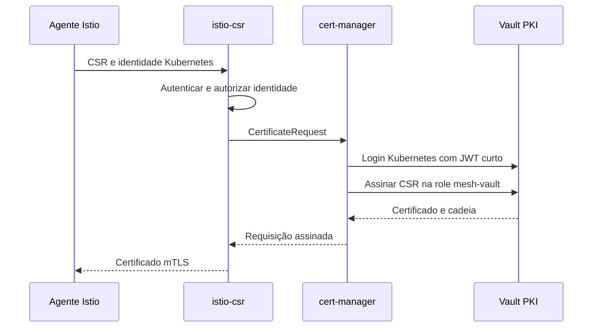

# Integrar Vault, cert-manager e Istio

## Fluxo



As chaves privadas dos workloads ficam no agente/proxy. A assinatura é delegada ao Vault; a decisão de acesso HTTP continua sendo do mesh. O cert-manager também pode emitir certificados para outros servidores pelo recurso Certificate.

## Sequência de instalação

1. Instale o Operator deste repositório e aguarde controller/webhook prontos.
2. Instale e inicialize Vault conforme o [guia do servidor](https://github.com/thiagobotelho/vault-gitops/blob/main/docs/INSTALACAO.md). O bootstrap prepara PKI, autenticação e cópias de confiança pública.
3. Neste checkout, aplique a integração e aguarde a prontidão:

```bash
oc apply -k integration/vault
oc -n istio-vault-system wait issuer/vault-pki --for=condition=Ready --timeout=120s
oc -n istio-csr-vault get istiocsr default
oc -n istio-csr-vault get pods
```

4. No checkout service-mesh-gitops, aplique optional/vault-lab. Exige Service Mesh Operator e IstioCNI existentes. Aguarde Istio mesh-vault saudável antes de criar workloads.
5. No checkout mesh-apps-lab, aplique scenarios/07-vault-pki e siga seu teste. Esse namespace usa a tag vault-stable; o mesh original mantém sua própria CA/revisão.

O IstioCSR desta versão exige o nome default e suas referências de Issuer/namespace têm campos imutáveis. Planeje esses valores antes da criação. O seletor istio-discovery=mesh-vault limita a distribuição da raiz aos namespaces desse laboratório e evita substituir a raiz de outro mesh.

## Quem mantém cada configuração

| Configuração | Fonte |
|---|---|
| Servidor, PKI, roles e autenticação Vault | vault-gitops |
| Operator, Issuer, TokenRequest RBAC e IstioCSR | cert-manager-gitops |
| Novo plano de controle/revisão/monitores | service-mesh-gitops/optional/vault-lab |
| Workloads e testes de política | mesh-apps-lab/scenarios/07-vault-pki |
| Applications e seleção opcional | argocd-gitops/optional/pki |

## Confiança e autenticação

vault-server-ca contém a CA HTTPS do Service Vault; vault-mesh-root contém a raiz pública da PKI. Esses dados são publicados pelo bootstrap e não são chaves privadas. O Issuer usa caBundleSecretRef e tokens de vault-issuer obtidos pelo TokenRequest API. O RoleBinding concede ao controller cert-manager apenas criação de token dessa conta, nesse namespace.

A role Kubernetes do Vault exige conta, namespace e audience. A policy mesh-sign autoriza somente o endpoint de assinatura configurado. O pedido precisa respeitar DNS, URI SAN e TTL da role PKI. Não habilite tokens permanentes ou allow_any_name para corrigir um teste negado.

## Validação

```bash
oc apply -f examples/certificate.yaml
oc -n istio-vault-system wait certificate/vault-demo --for=condition=Ready --timeout=120s
python3 scripts/verify-certificates.py
```

Confirme cadeia de assinatura, raiz esperada, SAN SPIFFE e validade curta. Teste também HTTP permitido, operação proibida e cliente plaintext. Root/chain sem erro não demonstra autorização HTTP; HTTP 200 sozinho não demonstra qual CA assinou o certificado.

O teste usa um mesh separado. Migrar um mesh já ativo para outra CA exige desenho de transição de confiança e não é executado automaticamente por esse perfil.

## Argo CD

No checkout argocd-gitops, optional/vault e optional/cert-manager instalam os pré-requisitos. Faça o bootstrap de PKI uma vez; depois aplique optional/pki para registrar Issuer/CSR, mesh separado e descoberta opcional no Kiali. Os workloads dos exercícios permanecem manuais.

Waves ordenam recursos dentro de uma Application; não garantem prontidão entre Applications distintas. Consulte as condições de cada etapa. Vault lacrado bloqueia novas emissões mesmo com o YAML sincronizado.

## Referências

- [Integração Service Mesh 3.4 e cert-manager](https://docs.redhat.com/en/documentation/red_hat_openshift_service_mesh/3.4/html/installing/ossm-cert-manager)
- [Vault Issuer](https://cert-manager.io/docs/configuration/vault/)
- [Istio CSR](https://cert-manager.io/docs/usage/istio-csr/)
